# Kayal Log

A voice logbook that lets Alappuzha houseboats prove where their sewage went.

Built solo at HackaThoni, Alappuzha, 21–22 November 2026.

## Screenshots

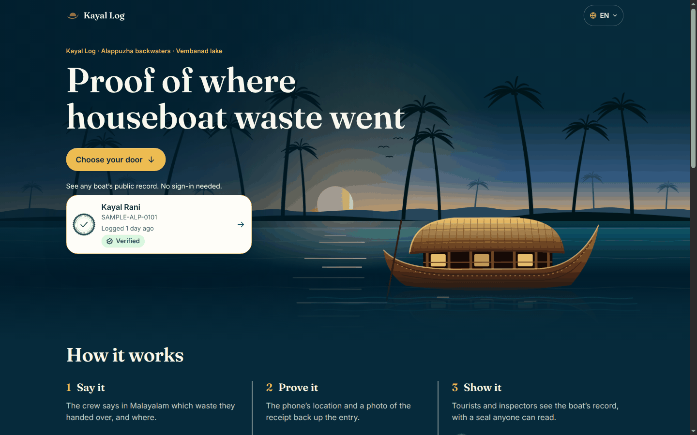

Landing — a live boat record and the voice-first logbook.

<table>
  <tr>
    <td valign="top" align="center">
      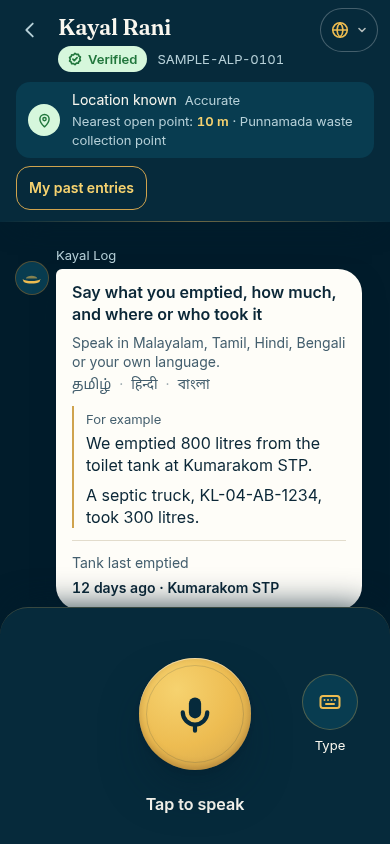
      <p>Log waste by voice.</p>
    </td>
    <td valign="top" align="center">
      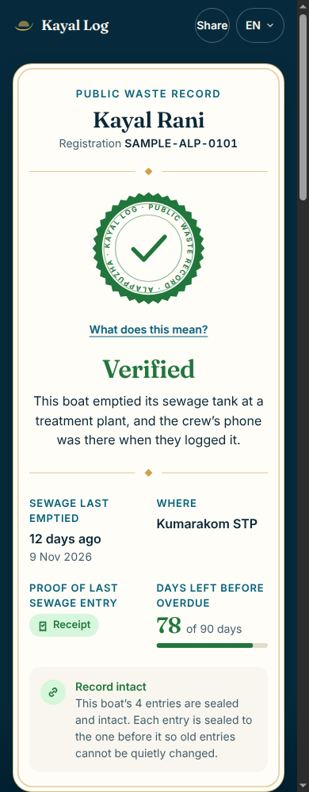
      <p>Public boat record.</p>
    </td>
    <td valign="top" align="center">
      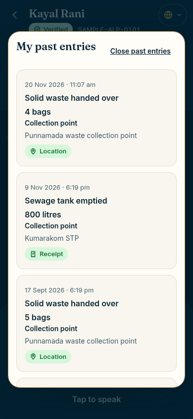
      <p>Crew’s past entries.</p>
    </td>
  </tr>
  <tr>
    <td valign="top" align="center">
      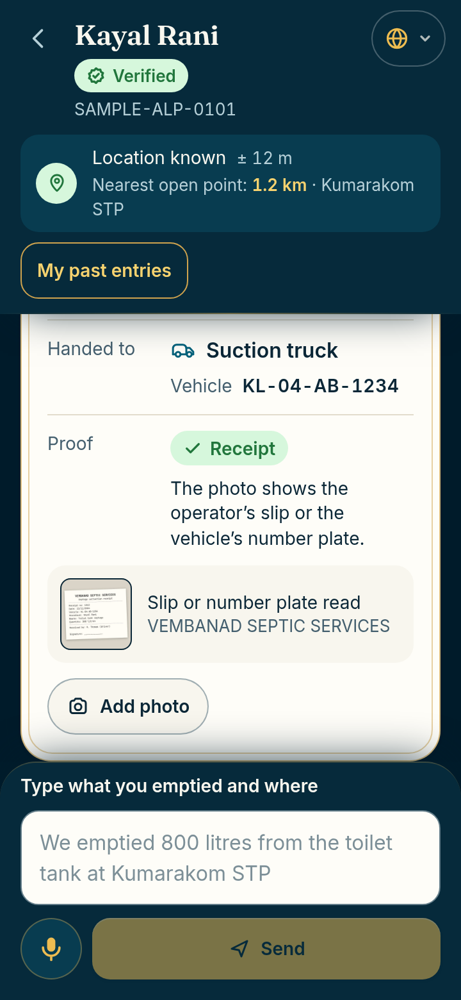
      <p>Handover code for the receiver.</p>
    </td>
    <td valign="top" align="center">
      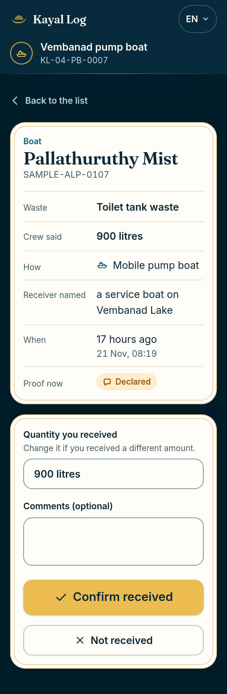
      <p>The receiver checks the handover.</p>
    </td>
    <td valign="top" align="center">
      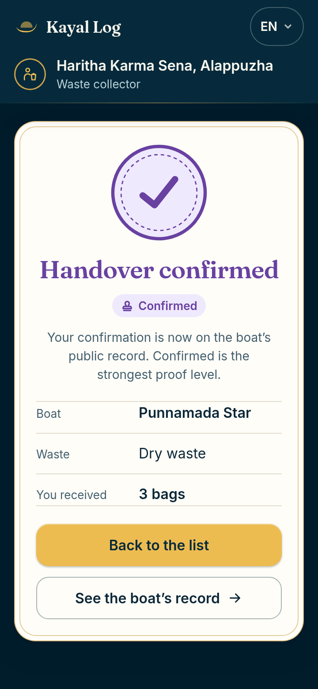
      <p>Handover confirmed.</p>
    </td>
  </tr>
</table>

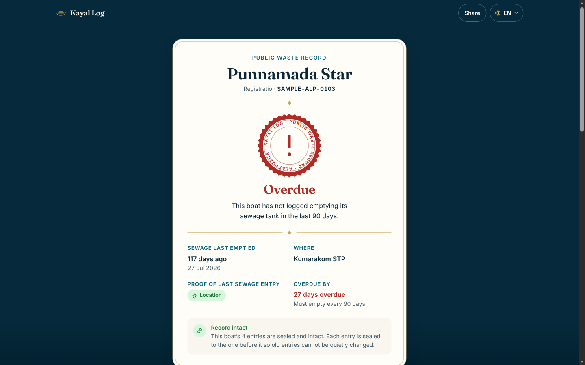

Overdue record — the boat’s status, last-entry proof and intact record.

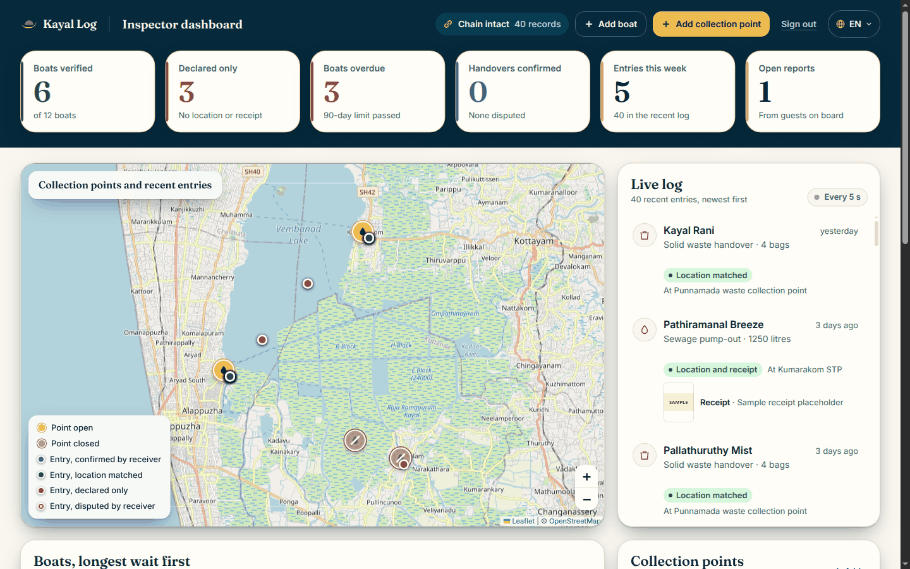

Inspector dashboard — the live map, weekly activity and recent waste handovers.

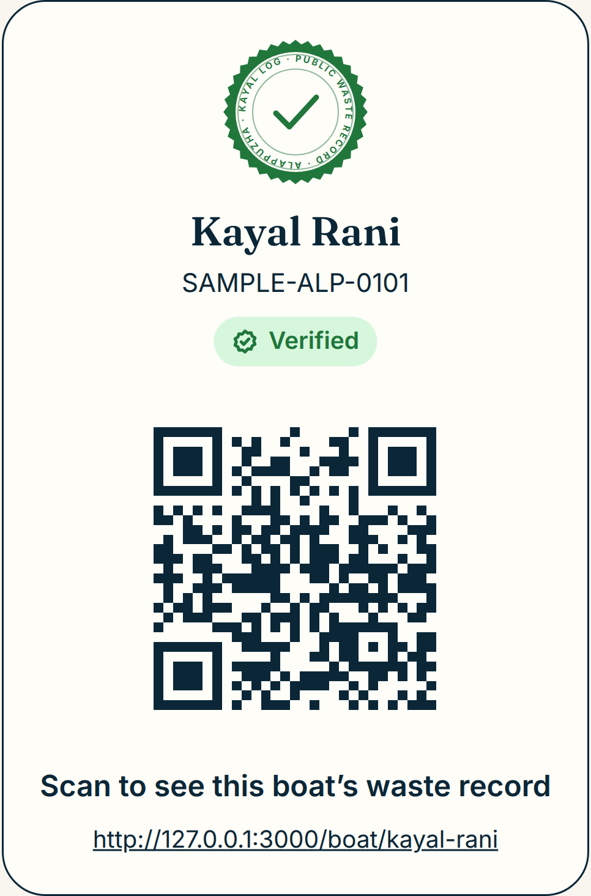

QR sticker — a printable link to Kayal Rani’s public waste record.

## The problem

The High Court ordered that houseboats without pollution control and valid certification may not run on Vembanad lake from 19 April 2026 (The Hindu / PTI, 17 April 2026). To renew a licence, a boat must empty its septage at a treatment plant every three months (New Indian Express, 16 October 2023). Only one of the two plants works (Down To Earth, 25 May 2026). Government estimates count about 700 registered and 750 unregistered houseboats (Down To Earth, 25 May 2026). Inspectors check them one at a time, and in April one boat without valid papers took so long that the team could not check the others (Onmanorama, 21 April 2026). There is no shared record of who emptied what.

## What it does

A crew member says what waste they emptied and who took it. The handover can be at a collection point, to a suction truck, a pump boat or a waste collector, or into a waste bin. Kayal Log records the vehicle number and the receiver, checks the phone's location against the known collection points, and adds the entry to the boat's public record. The crew's phone then shows a handover code and a QR code. The plant, truck or collector that took the waste confirms it on their own phone.

The crew can speak Malayalam, Tamil, Hindi or another Indian language, and they hear the reply in the language they spoke. They can also type. Recording takes one tap to start and one tap to send. After an entry is saved, the crew can add a receipt or slip photo to it, or tap Fix to correct a misheard quantity.

The screens open in English. Every page has a language switch for English, Malayalam, or English with Malayalam beside it, and it remembers the choice.

| Screen | Path | For | What happens |
| --- | --- | --- | --- |
| Landing and sign-in | `/` | Everyone | The product in one view, then three doors: Crew, Inspector, Guest. |
| Crew page | `/crew` | Boat crew, on a phone | Speak or type a handover, hear the reply, add a receipt photo, fix the quantity and show the handover code. |
| Receiver page | `/operator` | Receivers, on a phone | Treatment plants, suction trucks, pump boats and waste collectors sign in, scan or type the handover code, and mark it received or not received. Plants also record trucks that unload there. |
| Boat record | `/boat/<id>` | Tourists, on a phone | A certificate with a green, amber or red seal, the boat's log, and a form to report dumping with a photo. Reached by QR code. |
| Dashboard | `/dashboard` | Inspectors, on a laptop | Map, boats by urgency, live log, truck custody, tourist reports, QR stickers, CSV export and Call owner. |

Each entry gets one of four proof levels, from weakest to strongest.

| Level | Meaning |
| --- | --- |
| Declared | The crew said it. Nothing else confirms it. Handovers into a waste bin stay at this level. |
| Location | When the crew logged it, the phone was at an open collection point that takes this kind of waste. |
| Receipt | A photo backs the entry. At a collection point, the location matched and the photo was read as a receipt. For a truck, pump boat or collector, the photo shows the operator's slip or the vehicle's number plate. |
| **Confirmed** | The receiver confirmed on their own phone at `/operator` that they got the waste, within 3 days of the entry. |

If the receiver says the waste never reached them, the entry is marked Disputed. It drops to Declared, the boat's record shows the receiver's answer, and the entry no longer counts toward the boat's seal.

On the dashboard, an inspector can:

- See the truck chain of custody: for each suction truck and pump boat, the litres it confirmed picking up from boats over the last 30 days against the litres plants recorded it unloading. A gap is flagged.
- Withdraw an entry with a reason. The entry stays on the record, marked Withdrawn, and stops counting toward the seal.
- Add boats, collection points and receivers, and mark plants open or closed.
- Print a QR sticker for each boat and export the boat list as CSV.
- Review tourist reports. `gemma4` describes each report photo and says whether it looks like waste in the water.
- Tap **Call owner** for a boat that is due or overdue. Sarvam Voice Agents phones the owner with a reminder in Malayalam or English.

## How it works

One voice entry, from the microphone to a confirmed record:

1. The crew member speaks into the phone. The browser records the audio.
2. Sarvam `saaras:v4` turns the speech into text in the language spoken, and into English. Typed text in another language goes through `sarvam-translate:v1`.
3. Sarvam `gemma4` reads the English sentence and returns the kind of waste, the handover method, the quantity, the vehicle number, the receiver and the place.
4. For a collection point, the server compares the phone's position with the known collection points, taking open or closed status into account.
5. If the crew adds a receipt or slip photo, Sarvam `gemma4` reads it.
6. The server sets the proof level: Declared, Location or Receipt.
7. The server stores the entry with a six-character handover code. Each record holds the SHA-256 hash of the record before it, so a later edit breaks the chain and shows.
8. Sarvam `sarvam-translate:v1` translates the English reply into the language the crew spoke, and Sarvam `bulbul:v3` speaks it.
9. The receiver scans the QR code on the crew's phone, or types the handover code, at `/operator`. Their answer is added to the same chain. Received raises the entry to Confirmed. Not received marks it Disputed.
10. Tourists see the entry on the boat record. Inspectors see it on the dashboard, along with the truck custody totals.

The **Call owner** reminder runs separately. The server writes the reminder from the boat's pump-out status and an open sewage collection point, `sarvam-translate:v1` translates it into Malayalam, and Sarvam Voice Agents places the call.

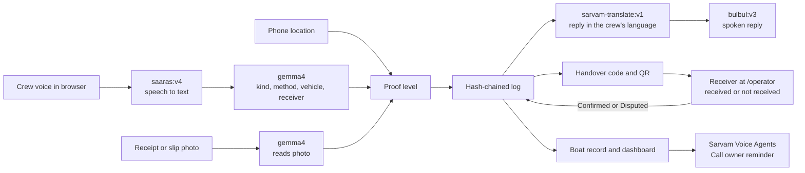

## Tracks

Kayal Log is one solution for all three tracks.

Primary track: 01 Place & People, the Alappuzha challenge. The problem is Alappuzha's houseboats and their waste, and the users are the crew, receivers, tourists and inspectors on that lake.

- 02 Voice & Language: the crew speaks Malayalam, Tamil, Hindi or another Indian language and hears the reply in that language, all through Sarvam. A crew member does not need to type or read English. The owner reminder is a phone call through Sarvam Voice Agents. The screens offer English, Malayalam, or both side by side.
- 03 Physical-world computing: the phone's location, the receipt photo and the vehicle's number plate tie each entry to a real place and a real object. The receiver confirms by scanning a QR code on the crew's phone, the boat carries a QR sticker, and truck pickups are checked against plant unloads in litres.

## Tech stack

| Part | Choice |
| --- | --- |
| Frontend | Vite, React, TypeScript, Tailwind CSS v4, Motion, React Router. In `web/`. |
| Backend | Node.js 22 or later. One small server, `server.mjs`, with no dependencies. |
| Data | One JSON file plus photo files. Each record is chained to the previous one by a hash. |
| Voice and AI | Sarvam: `saaras:v4` (speech to text), `sarvam-translate:v1` (translation), `bulbul:v3` (speech), `gemma4` (reads the sentence, the receipt and tourist photos), Sarvam Voice Agents (the owner reminder call). |
| Map | Leaflet with OpenStreetMap. |
| Fonts | Fraunces, Inter and the Anek family for Malayalam, Tamil, Devanagari, Bangla and Odia, bundled from npm. |

## Run it

You need Node.js 22 or later and a Sarvam API key.

```bash
cp .env.example .env        # then set SARVAM_API_KEY and ADMIN_PIN
(cd web && npm install && npm run build)
npm start                   # runs node server.mjs
```

The server prints `Kayal Log is running at http://127.0.0.1:3000`. It serves the built frontend from `web/dist`.

Environment variables, set in `.env` or the shell:

| Variable | What it does | Default |
| --- | --- | --- |
| `SARVAM_API_KEY` | Key for the Sarvam calls. Without it, voice logging fails. | None |
| `ADMIN_PIN` | The shared inspector PIN. If empty, inspector writes need no PIN. | Empty |
| `PUBLIC_URL` | Public HTTP(S) base URL used for QR codes and printed links. | Browser origin |
| `PORT` | Port the server listens on. | `3000` |
| `HOST` | Address the server listens on. | `127.0.0.1` |
| `DATA_DIR` | Where the JSON data and uploaded photos are stored. | `data/` in the repository |
| `SARVAM_TIMEOUT_MS` | Deadline for each Sarvam request, in milliseconds. | `40000` |
| `BODY_TIMEOUT_MS` | Deadline for receiving a JSON body, in milliseconds. | `40000` |
| `OVERDUE_DAYS` | Days after which a boat with no sewage entry counts as overdue. | `90` |
| `SAMVAAD_API_KEY` | Optional. Sarvam Voice Agents key for the Call owner reminder. | None |
| `SAMVAAD_ORG_ID` | Optional. Sarvam Voice Agents organisation. | None |
| `SAMVAAD_WORKSPACE_ID` | Optional. Sarvam Voice Agents workspace. | None |
| `SAMVAAD_APP_ID` | Optional. The voice agent app that makes the call. | None |
| `SAMVAAD_APP_VERSION` | Optional. Version of that app, a whole number from 1. | None |
| `SAMVAAD_CONNECTION_ID` | Optional. The telephony connection for outbound calls. | None |
| `SAMVAAD_AGENT_NUMBER` | Optional. The phone number the call comes from. | None |
| `REMINDER_CALL_TO` | Optional. The number the reminder calls, in `+91…` form. | None |
| `REMINDER_OWNER_NAME` | Optional. The name the voice agent greets. | `boat owner` |

Call owner works only when `REMINDER_CALL_TO` and all the `SAMVAAD_*` variables are set. Without them, the rest of the app runs as normal.

Unit tests, which cover the proof rules in `lib/logic.mjs`:

```bash
npm test
```

To reset the demo data, stop the server and run `npm run reseed` (or `scripts/reseed`). It backs up the database inside `DATA_DIR` and removes it, and the next start loads fresh sample data.

Phones need an https link to allow the microphone and location.

## API

- All routes take and return JSON, except the live event stream. Errors look like `{"error":"..."}`.
- Crew log with `POST /api/log`. Anyone reads public records with `GET /api/state` and `GET /api/boats/:boatId`.
- Receivers confirm with `POST /api/log/:entryId/confirm`, signed in with their operator code.
- Inspector writes need the shared PIN in the `x-admin-pin` header.

Every route is described in [docs/API.md](docs/API.md).

## What is next

- Real sign-in: phone OTP for crews and receivers, and government accounts for inspectors.
- An offline queue, so the crew can log on the lake without signal and send it later.
- Plant-side intake records, so each plant keeps its own log of what it received.
- A native Malayalam speaker to check every line.
