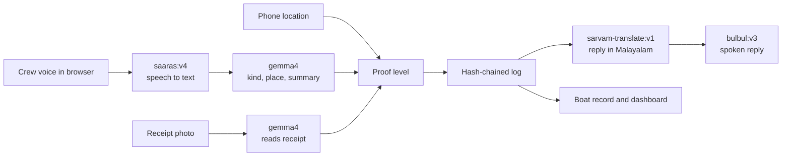

# Kayal Log

A voice logbook that lets Alappuzha houseboats prove where their sewage went.

Built solo at HackaThoni, Alappuzha, 21–22 November 2026.

## Screenshots

| | |
| --- | --- |
|  |  |
|  |  |

## The problem

The High Court ordered that houseboats without pollution control and valid certification may not run on Vembanad lake from 19 April 2026 (The Hindu / PTI, 17 April 2026). To renew a licence, a boat must empty its septage at a treatment plant every three months (New Indian Express, 16 October 2023). Only one of the two plants works (Down To Earth, 25 May 2026). Government estimates count about 700 registered and 750 unregistered houseboats (Down To Earth, 25 May 2026). Inspectors check them one at a time, and in April one boat without valid papers took so long that the team could not check the others (Onmanorama, 21 April 2026). There is no shared record of who emptied what.

## What it does

A crew member says in Malayalam what waste they emptied and where. Kayal Log checks the phone's location against the known collection points and reads a photo of the receipt. It adds the entry to a public record for that boat. Every screen shows Malayalam next to its English meaning.

| Screen | Path | For | What happens |
| --- | --- | --- | --- |
| Landing and sign-in | `/` | Everyone | The product in one view, then three doors: Crew, Inspector, Guest. |
| Crew page | `/crew` | Boat crew, on a phone | One big button to speak, a receipt photo, a spoken Malayalam reply. |
| Boat record | `/boat/<id>` | Tourists, on a phone | A certificate with a green, amber or red seal, and the boat's log. Reached by QR code. |
| Dashboard | `/dashboard` | Inspectors, on a laptop | Map, boats by urgency, live log, QR codes, open or closed plants. |

Each entry gets one of three proof levels.

| Level | Meaning |
| --- | --- |
| Declared | The crew said it. Nothing else confirms it. |
| Location | The phone was at an open collection point when they said it. |
| Receipt | Location matched and the receipt photo was read. |

## How it works

One voice entry, from the microphone to the public record:

1. The crew member speaks into the phone. The browser records the audio.
2. Sarvam `saaras:v4` turns the speech into text.
3. Sarvam `gemma4` reads the sentence and returns the kind of waste, the place and a short summary.
4. The server compares the phone's position with the known collection points, taking open or closed status into account.
5. If the crew adds a receipt photo, Sarvam `gemma4` reads it.
6. The server sets the proof level: Declared, Location or Receipt.
7. The server stores the entry. It holds the SHA-256 hash of the entry before it, so a later edit breaks the chain and shows.
8. Sarvam `sarvam-translate:v1` translates the English reply into Malayalam.
9. Sarvam `bulbul:v3` speaks the Malayalam reply to the crew.
10. Tourists see the entry on the boat record. Inspectors see it on the dashboard.



## Tracks

Primary track: 01 Place & People, the Alappuzha challenge. The problem is Alappuzha's houseboats and their waste, and the users are the crew, tourists and inspectors on that lake.

- 02 Voice & Language: the crew speaks Malayalam and hears Malayalam back, all through Sarvam. A crew member does not need to type or read English.
- 03 Physical-world computing: the phone's location and the receipt photo tie each entry to a real place and a real piece of paper.

## Tech stack

| Part | Choice |
| --- | --- |
| Frontend | Vite, React, TypeScript, Tailwind CSS v4, Motion, React Router. In `web/`. |
| Backend | Node.js 22 or later. One small server, `server.mjs`, with no dependencies. |
| Data | One JSON file plus photo files. Each entry is chained to the previous one by a hash. |
| Voice and AI | Sarvam: `saaras:v4` (speech to text), `sarvam-translate:v1` (translation), `bulbul:v3` (speech), `gemma4` (reads the sentence and the receipt). |
| Map | Leaflet with OpenStreetMap. |
| Fonts | Fraunces, Inter and Anek Malayalam, bundled from npm. |

## Run it

You need Node.js 22 or later and a Sarvam API key.

```bash
cp .env.example .env        # then set SARVAM_API_KEY and ADMIN_PIN
(cd web && npm install && npm run build)
npm start                   # runs node server.mjs
```

The server prints `Kayal Log is running at http://127.0.0.1:3000`. It serves the built frontend from `web/dist`.

Environment variables, set in `.env` or the shell:

| Variable | What it does | Default |
| --- | --- | --- |
| `SARVAM_API_KEY` | Key for the Sarvam calls. Without it, voice logging fails. | None |
| `ADMIN_PIN` | The shared inspector PIN. If empty, inspector writes need no PIN. | Empty |
| `PUBLIC_URL` | Public HTTP(S) base URL used for QR codes and printed links. | Browser origin |
| `PORT` | Port the server listens on. | `3000` |
| `HOST` | Address the server listens on. | `127.0.0.1` |
| `DATA_DIR` | Where the JSON data and uploaded photos are stored. | `data/` in the repository |
| `SARVAM_TIMEOUT_MS` | Deadline for each Sarvam request, in milliseconds. | `40000` |
| `BODY_TIMEOUT_MS` | Deadline for receiving a JSON body, in milliseconds. | `40000` |
| `OVERDUE_DAYS` | Days after which a boat with no sewage entry counts as overdue. | `90` |

Unit tests, which cover the proof rules in `lib/logic.mjs`:

```bash
npm test
```

Phones need an https link to allow the microphone and location.

## API

- All routes take and return JSON, except the live event stream. Errors look like `{"error":"..."}`.
- Crew log with `POST /api/log`. Anyone reads public records with `GET /api/state` and `GET /api/boats/:boatId`.
- Inspector writes need the shared PIN in the `x-admin-pin` header.

Every route is described in [docs/API.md](docs/API.md).

## What is next

- Real sign-in: phone OTP for crews and government accounts for inspectors.
- A native Malayalam speaker to check every line.
